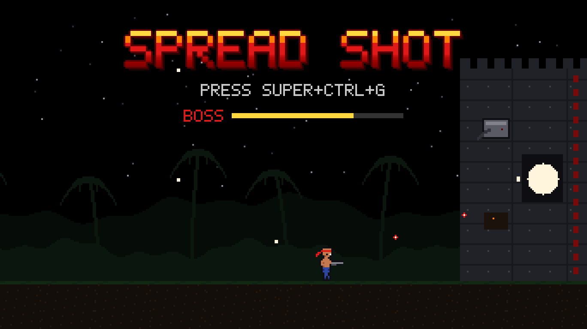

# Spread Shot

An all-black, arcade-red [Omarchy](https://omarchy.org) theme with an optional **playable wallpaper**:
a pixel-art run-and-gun game that the computer plays in the background and that you can take
over with the arrow keys at any time.



## What's in it

**The theme** (colors and images only, like any Omarchy theme)

- Pure `#000000` backgrounds for the bar, menus, launcher, notifications, terminals and lock screen
- Arcade red `#e01818` accents with explosion orange and yellow highlights
- Red-to-orange window borders
- Four pixel-art backgrounds, one per stage: jungle, snowfield, enemy base, alien hive

**The game** (optional, installed separately)

- Runs as your wallpaper; an AI plays it while you work
- Press <kbd>Super</kbd>+<kbd>Ctrl</kbd>+<kbd>G</kbd> to play: <kbd>←</kbd> <kbd>→</kbd> move,
  <kbd>↑</kbd> jumps, <kbd>↓</kbd> ducks, firing is automatic. <kbd>Esc</kbd> hands the keyboard back
- Four stages, each ending in a boss: a defense wall, a tank, a shielded reactor and an alien heart
- Shoot the flying capsule for the spread gun; 3 lives, an extra one every 20,000 points
- Beat all four for the ending, then loop 2 begins with tougher enemies. Your high score is saved
- About 7 MB of RAM; drawn on the CPU (no GPU), and it stops drawing entirely while windows cover it

## Install

### 1. The theme

```sh
omarchy theme install https://github.com/wiseman-umanah/omarchy-spread-shot-theme
```

This works on its own: you get the colors and the four stills as backgrounds.

### 2. The playable wallpaper (optional)

Omarchy never runs code from a theme, so the game is a separate, opt-in step. It builds from
source in a few seconds:

```sh
sudo pacman -S --needed base-devel wayland wayland-protocols
make -C ~/.config/omarchy/themes/spread-shot/game install
```

`make install` puts three things on your system, and `make uninstall` removes all of them:

| What | Where |
|---|---|
| The `spread-shot` binary | `~/.local/bin/spread-shot` |
| Hooks that start it while this theme is active, and stop it for any other theme | `~/.config/omarchy/hooks/theme-set.d/` and `post-boot.d/` |
| The <kbd>Super</kbd>+<kbd>Ctrl</kbd>+<kbd>G</kbd> game-mode keybinding (skipped if that key is taken) | `~/.config/hypr/bindings.lua`, between `-- >>> spread-shot` markers |

After `omarchy theme update`, run the `make ... install` line again to rebuild the game.

### Uninstall

```sh
make -C ~/.config/omarchy/themes/spread-shot/game uninstall
```

Your high score stays in `~/.local/state/spread-shot/` until you delete it.

## How it works

- `spread-shot` is a single C program that talks to the compositor through `wlr-layer-shell`,
  so it should also run on Sway, River and other wlroots-style compositors.
- It draws at 342×192 and scales up nearest-neighbor into shared memory. No GPU is used, which
  also keeps it clear of flaky GPU drivers.
- Drawing is driven by the compositor's frame callbacks, so when windows cover the wallpaper
  the compositor stops asking for frames and the game uses no CPU.
- Game mode moves the surface to the top layer and takes the keyboard (Hyprland's own
  shortcuts keep working). <kbd>Esc</kbd>, the same shortcut again, game over, or 45 seconds
  without a key press hands the keyboard back.
- The game-mode shortcut just sends `SIGUSR1`, so you can bind it to any key:
  `pkill -USR1 -x spread-shot`.

## Development

```sh
cd game
make          # build ./spread-shot
make check    # headless tests: all stages and bosses clear, ending plays, game over works
make art      # re-render backgrounds/, preview.png and unlock.png from the game (needs ImageMagick)
./spread-shot --stage 3 --boss   # run it (stop your installed copy first: pkill -x spread-shot)
./spread-shot --help
```

```
.
├── colors.toml, icons.theme      theme palette and icon set
├── backgrounds/                  one still per stage (rendered by `make art`)
├── preview.png, unlock.png       theme picker preview and lock-screen logo
└── game/
    ├── src/                      main.c (Wayland + CLI), game.c, stage.c, art.c, gfx.c
    ├── protocol/                 vendored wlr-layer-shell protocol XML
    ├── scripts/                  install, uninstall, Omarchy hook, artwork renderer
    └── tests/check.sh            headless gameplay tests
```

## License

[MIT](LICENSE). `game/protocol/wlr-layer-shell-unstable-v1.xml` is from
[wlr-protocols](https://gitlab.freedesktop.org/wlroots/wlr-protocols) and keeps its own
license notice. All artwork is original, drawn in code.
